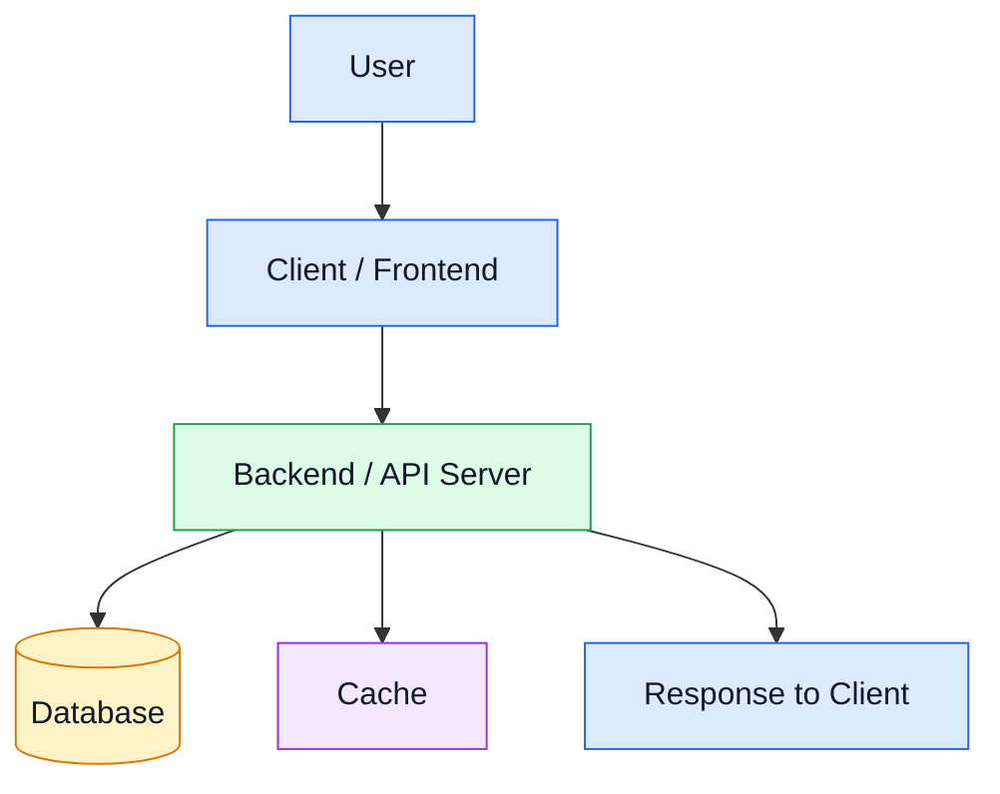

# 🚀 System Design Learning

  <strong>My journey from System Design fundamentals to scalable, reliable and distributed systems.</strong>

  
  
  

---

## 📌 About This Repository

Welcome to my **System Design Learning Repository**!

This repository documents my journey of learning System Design from the basics. I am building my understanding step by step through lectures, notes, architecture diagrams, practical examples, and real-world system design problems.

The goal is not just to learn theoretical concepts, but to understand **how real-world applications are designed to handle users, data, traffic, failures, and growth.**

### 🎯 Goals

- Understand the fundamentals of System Design.
- Learn how clients, servers, databases, caches, and APIs work together.
- Understand scalability, availability, reliability, and performance.
- Explore SQL and NoSQL databases, caching, and load balancing.
- Learn distributed systems and their fundamental trade-offs.
- Design real-world applications through practical case studies.
- Maintain clear notes and diagrams for future revision and interviews.

---

## 🏗️ What Is System Design?

System Design is the process of defining the architecture, components, data flow, and interactions required to build a software system that meets its functional and non-functional requirements.

A simplified application architecture looks like this:

*This is a simplified conceptual diagram. Actual architectures vary depending on the application and its requirements.*

---

## 🗺️ Learning Roadmap

The following roadmap represents the topics I plan to explore progressively. I will update the progress as I study each topic.

- [ ] **01. Introduction to System Design**
  - Purpose and importance of System Design
  - Basic application architecture
  - Clients, servers, databases, caches, and APIs
  - Request-response lifecycle

- [ ] **02. Application Types and Requirements**
  - Data-intensive vs. compute-intensive applications
  - Functional requirements
  - Non-functional requirements
  - Scalability, availability, reliability, and latency

- [ ] **03. Networking and APIs**
  - DNS and domain resolution
  - HTTP and HTTPS fundamentals
  - REST APIs
  - GraphQL basics
  - gRPC fundamentals

- [ ] **04. Databases and Storage**
  - SQL vs. NoSQL
  - Relational and non-relational databases
  - Database indexes
  - Database replication
  - Database partitioning and sharding

- [ ] **05. Caching and Load Balancing**
  - What is caching?
  - Cache strategies and invalidation
  - Redis fundamentals
  - Load balancing
  - Horizontal vs. vertical scaling

- [ ] **06. Distributed Systems**
  - Distributed system fundamentals
  - Replication and partitioning
  - Consistency and availability
  - CAP theorem
  - Fault tolerance

- [ ] **07. Asynchronous Systems and Monitoring**
  - Synchronous vs. asynchronous communication
  - Message queues
  - Event-driven architecture
  - Logging, metrics, and monitoring
  - Handling failures and retries

- [ ] **08. Practical System Design**
  - URL Shortener
  - Rate Limiter
  - Notification System
  - Chat Application
  - File Storage System
  - News Feed
  - Video Streaming Platform

---

## 📚 Daily Learning Notes

This section will grow as I progress through the course.

| Session | Topics | Status |
|---|---|---|
| Day 01 | Introduction to System Design and concepts covered in the initial lecture | 🟡 In Progress |
| Day 02+ | Upcoming lecture notes and concepts | ⏳ Planned |

Detailed notes, explanations, examples, and diagrams will be maintained in the [`Notes`](./Notes/) directory.

> Progress will be updated only after studying and understanding the corresponding topics.

---

## 🖼️ Architecture Diagrams

Visual diagrams help explain how different components of a system communicate with one another.

As I progress, this repository will include diagrams for:

- Client-server architecture
- Request-response lifecycle
- Database architecture
- Caching layers
- Load balancing
- Distributed systems
- Real-world application architectures

Diagrams will be added progressively alongside the relevant notes.

---

## 🧠 How I Study Each Concept

For every major topic, I aim to document:

1. **Definition:** What is the concept?
2. **Purpose:** Why do we need it?
3. **Working:** How does it work internally?
4. **Diagram:** How do the components interact?
5. **Example:** Where is it used in real applications?
6. **Trade-offs:** What are its advantages and limitations?
7. **Revision:** Key takeaways and questions to revisit.

---

## 🛠️ Tools and Resources

- **GitHub:** Maintaining notes, diagrams, and learning progress.
- **Markdown:** Writing structured technical documentation.
- **Mermaid:** Creating architecture and flow diagrams directly in Markdown.
- **System Design courses and documentation:** Understanding concepts through lectures and further reading.

Useful learning resources:

- [System Design Primer](https://github.com/donnemartin/system-design-primer)
- [MDN Web Docs](https://developer.mozilla.org/)
- [Mermaid Documentation](https://mermaid.js.org/)

---

## 📈 My Learning Philosophy

> Learn the fundamentals. Understand the trade-offs. Visualize the architecture. Apply the concepts to real-world problems.

This is an evolving learning repository, not a collection of topics marked complete without understanding them.

I will keep improving it with daily notes, diagrams, examples, and practical system design exercises.

---

  <strong>Building my System Design knowledge one concept at a time. 🚀</strong>

