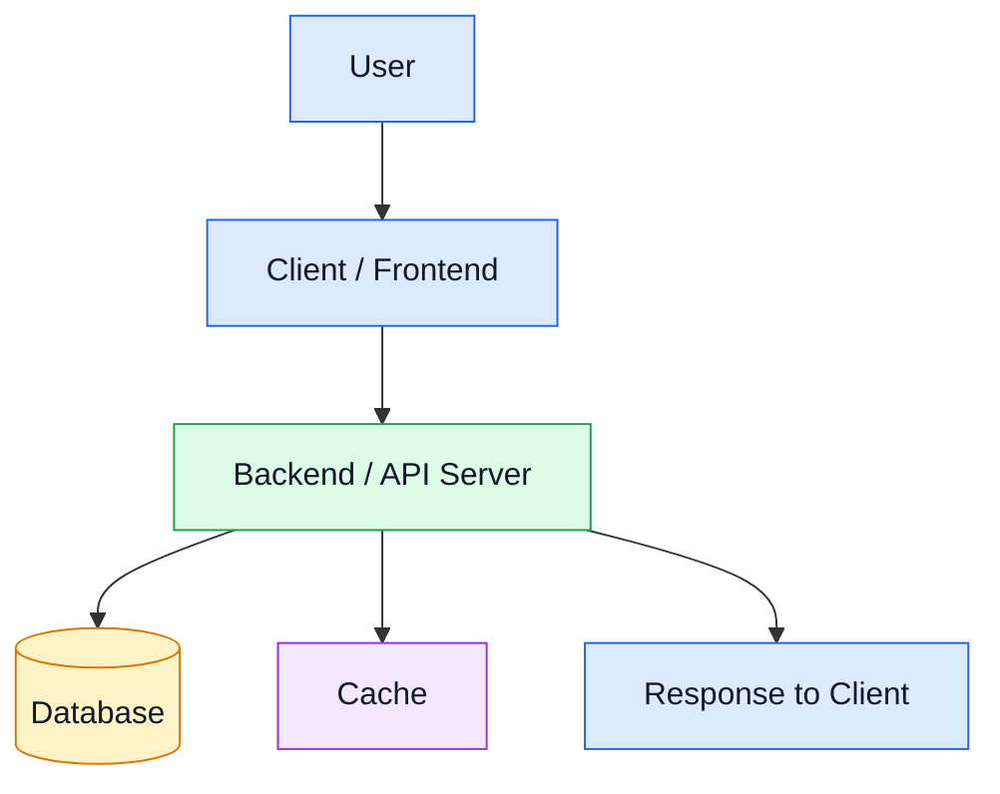

# 🚀 System Design Learning

  <strong>Learning System Design from Fundamentals to Scalable Architecture</strong>

  
  

---

## 📌 About This Repository

Welcome to **System Design Learning**!

This repository documents our journey of learning System Design from the basics. It will contain concepts, technical notes, architecture diagrams, practical examples, and real-world system design problems as we progress through the learning process.

The objective is to understand how modern software applications are designed to handle increasing users, growing data, network communication, failures, and changing requirements.

### 🎯 Goals

- Understand the fundamentals of System Design.
- Learn how clients, servers, databases, caches, and APIs interact.
- Explore scalability, availability, reliability, and performance.
- Understand SQL and NoSQL databases, caching, and load balancing.
- Learn distributed systems and their fundamental trade-offs.
- Practice designing real-world applications.
- Maintain clear technical notes and architecture diagrams for revision.

---

## 🏗️ What Is System Design?

System Design is the process of defining the architecture, components, data flow, and interactions required to build a software system that meets its functional and non-functional requirements.

A simplified application architecture looks like this:

*This is a simplified conceptual diagram. Actual architectures depend on application requirements.*

---

## 🗺️ System Design Roadmap

The following roadmap outlines the concepts we plan to explore progressively.

- [ ] **01. Introduction to System Design**
  - Purpose and importance of System Design
  - Basic application architecture
  - Clients, servers, databases, caches, and APIs
  - Request-response lifecycle

- [ ] **02. Application Types and Requirements**
  - Data-intensive vs. compute-intensive applications
  - Functional and non-functional requirements
  - Scalability, availability, reliability, and latency

- [ ] **03. Networking and APIs**
  - DNS and domain resolution
  - HTTP and HTTPS
  - REST APIs
  - GraphQL fundamentals
  - gRPC fundamentals

- [ ] **04. Databases and Storage**
  - SQL vs. NoSQL
  - Relational and non-relational databases
  - Database indexes
  - Replication
  - Partitioning and sharding

- [ ] **05. Caching and Load Balancing**
  - Caching fundamentals
  - Cache strategies and invalidation
  - Redis fundamentals
  - Load balancing
  - Horizontal vs. vertical scaling

- [ ] **06. Distributed Systems**
  - Distributed system fundamentals
  - Replication and partitioning
  - Consistency and availability
  - CAP theorem
  - Fault tolerance

- [ ] **07. Asynchronous Systems and Monitoring**
  - Synchronous vs. asynchronous communication
  - Message queues
  - Event-driven architecture
  - Logging, metrics, and monitoring
  - Retries and failure handling

- [ ] **08. Practical System Design**
  - URL Shortener
  - Rate Limiter
  - Notification System
  - Chat Application
  - File Storage System
  - News Feed
  - Video Streaming Platform

---

## 🖼️ Architecture and Visual Learning

Visual diagrams help explain how components communicate and how data flows through a system.

This repository will gradually include architecture diagrams covering:

- Client-server communication
- Request-response lifecycle
- Database architecture
- Caching layers
- Load balancing
- Distributed systems
- Real-world application architectures

Diagrams and relevant images will be added alongside the concepts as we learn them.

---

## 🧠 Learning Approach

For each concept, the aim is to understand:

1. **Definition:** What is it?
2. **Purpose:** Why is it needed?
3. **Working:** How does it work?
4. **Architecture:** How do the components interact?
5. **Practical Examples:** Where is it used?
6. **Trade-offs:** What are its advantages and limitations?
7. **Revision:** What are the key takeaways?

The focus is on understanding concepts step by step rather than simply memorizing definitions.

---

## 👥 Contributors

| Name | Role |
|---|---|
| Sakshi Kumari | Contributor |
| Prem Kumar Gupta | Contributor |

---

  <strong>Learning, Designing, and Growing — One Concept at a Time. 🚀</strong>

